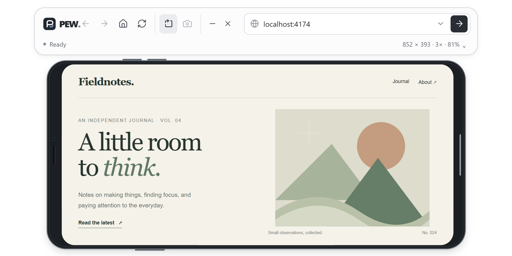
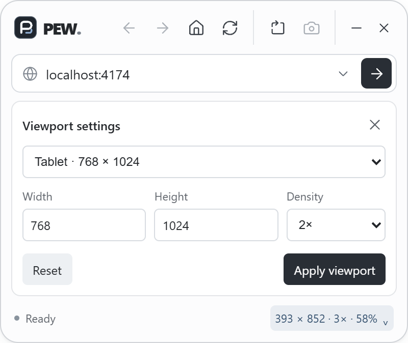
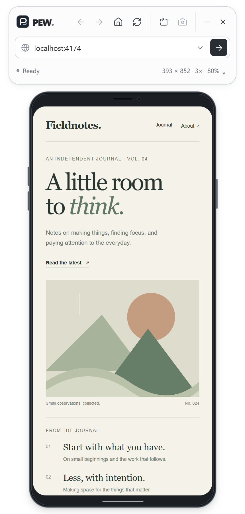

<p align="center">
  
</p>

<h1 align="center">PEW</h1>

<p align="center">Phone and tablet previews, in a desktop window.</p>

<p align="center">
  <a href="https://github.com/M0-kii/pew/releases/latest">Download for Windows</a>
  · <a href="#getting-started">Run from source</a>
  · <a href="#controls">Controls</a>
</p>

PEW opens websites and local development servers in a resizable device frame. Pick a preset or enter exact dimensions, rotate the viewport, and save a PNG of the page.

<p align="center">
  
</p>

## Features

- **Presets and custom viewports.** Compact phone, phone, large phone, and tablet presets, plus custom dimensions from 240 to 1920 pixels per side.
- **Pixel density.** Switch between 1×, 2×, and 3× emulation in the Windows app.
- **State-preserving rotation.** Change dimensions or orientation while keeping the page, navigation history, and form contents.
- **Fit to your workspace.** Resize the app window; the preview scales to fit while its logical viewport stays fixed.
- **Quick navigation.** An editable address bar, Back, Forward, Home, Reload, Stop, and keyboard shortcuts.
- **Recent URLs.** Five local entries, available from the address bar, with a Clear control.
- **PNG screenshots.** Save to `Pictures/PEW` and open the destination folder from the confirmation.
- **Saved viewport settings.** Your dimensions and density are restored when you reopen the app.
- **Recoverable loading.** Progress feedback, direct Retry actions, and automatic cancellation after 20 seconds.

## Viewport settings

Click the dimensions beneath the address bar to open viewport settings. Choose a preset or enter a width, height, and density, then select **Apply viewport**. **Reset** fills in the default 393 × 852 viewport at 3× density.

<p align="center">
  
</p>

Rotation swaps the current width and height. Resizing the window changes the display scale rather than the website's layout dimensions. The status row shows the viewport size, pixel density, and display scale.

## Portrait preview

<p align="center">
  
</p>

Screenshots show the current source build with a local sample website. Native mobile emulation, page history, and screenshot export require the Windows desktop app.

## Getting started

Download an installer from [Releases](https://github.com/M0-kii/pew/releases/latest), or run the current source for the latest features. Release assets include a SHA-256 checksum. Installers are currently unsigned.

To run from source, install Node.js 22.18 or later, pnpm, a Rust toolchain, and the [desktop prerequisites](https://v2.tauri.app/start/prerequisites/).

```sh
pnpm install
pnpm tauri dev
```

Enter a website or a local development address such as `localhost:3000`, then press Enter. Public addresses default to HTTPS; localhost, loopback, and private network addresses default to HTTP.

To build an installer:

```sh
pnpm tauri build
```

`pnpm dev` runs the interface in a browser using an iframe. The previewed website must allow embedding; browser preview does not provide native density emulation or screenshot export.

## Controls

| Action                                 | Control                                           |
| -------------------------------------- | ------------------------------------------------- |
| Select the address                     | Ctrl+L                                            |
| Open an address                        | Enter                                             |
| Restore the current address            | Escape in the address field                       |
| Reload                                 | Ctrl+R or F5                                      |
| Back / Forward                         | Alt+Left / Alt+Right                              |
| Open recent URLs                       | Down in the address field, or its dropdown button |
| Move through recent URLs               | Up / Down                                         |
| Close recent URLs or viewport settings | Escape                                            |
| Change dimensions or density           | Click the dimensions in the status row            |
| Rotate                                 | Rotation button                                   |
| Save a screenshot                      | Camera button                                     |
| Return to the start screen             | Home button                                       |

Navigation shortcuts work while the website has focus in the Windows app. Stop cancels the current load. Home closes the website and selects its last address.

Recent URLs and viewport settings stay on your computer. Saved URLs omit query strings and fragments, and addresses containing embedded credentials are excluded. Clear removes recent URLs; it does not clear the website's own browsing data.

## Checks

Install the integration-test browser once:

```sh
pnpm exec playwright install chromium
```

Run the checks:

```sh
pnpm test
pnpm build
pnpm format:check
cargo fmt --check --manifest-path src-tauri/Cargo.toml
cargo test --locked --manifest-path src-tauri/Cargo.toml
cargo clippy --locked --manifest-path src-tauri/Cargo.toml -- -D warnings
```

The tests cover URL validation, local history, viewport settings, navigation state, keyboard controls, and browser flows. For native desktop tests on Windows, build the debug executable and enable the native suite:

```powershell
cargo build --locked --manifest-path src-tauri/Cargo.toml
$env:PEW_NATIVE_TEST = "1"
pnpm test
```

Native checks cover viewport dimensions, density changes, history, cancellation, state-preserving rotation, and PNG export. Test exports are removed afterward. Release-mode tests use the `test-driver` feature with a loopback-only debugger; published installers are built without it.

## Project structure

| Path                               | Purpose                                          |
| ---------------------------------- | ------------------------------------------------ |
| `src/main.ts`                      | Interface state and interactions                 |
| `src/ui.html`, `src/style.css`     | Interface markup and styling                     |
| `src/viewport.ts`                  | Viewport presets, validation, and saved settings |
| `src/native.ts`                    | Typed desktop browser commands                   |
| `src/config.ts`, `src/rotation.ts` | Window dimensions, timing, and resizing          |
| `src/navigation.ts`                | Navigation identity and cancellation             |
| `src/history.ts`, `src/url.ts`     | Recent URLs and address validation               |
| `src-tauri/src/`                   | Desktop commands and native browser integration  |
| `public/brand/`                    | Vector logo                                      |
| `docs/screenshots/`                | README screenshots                               |
| `tests/`                           | Unit and integration tests                       |

## Releases

Checks run for pushes and pull requests. To publish a release, update the version in `package.json`, `src-tauri/Cargo.toml`, and `src-tauri/tauri.conf.json`, update the lockfiles, then push a matching `vX.Y.Z` tag. The release workflow runs the Windows test suite before publishing the installer and checksum.

To regenerate app icons from the vector source:

```sh
pnpm tauri icon public/brand/pew-mark.svg
```
